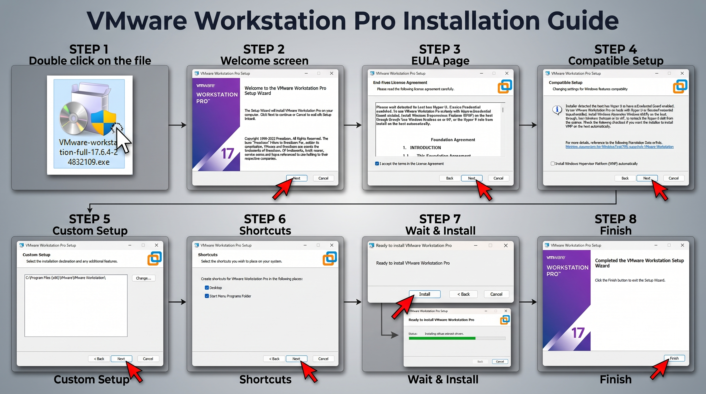
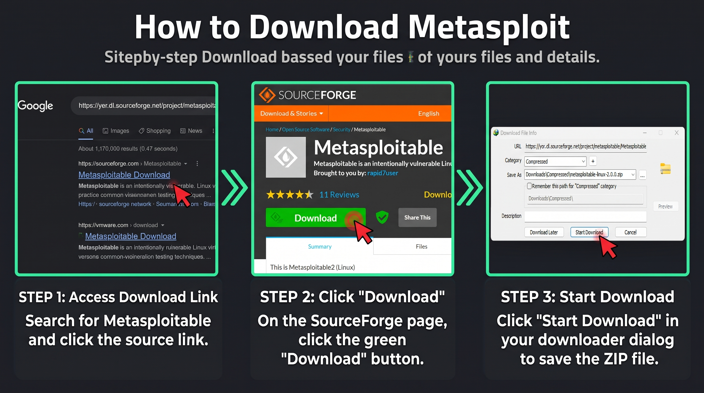
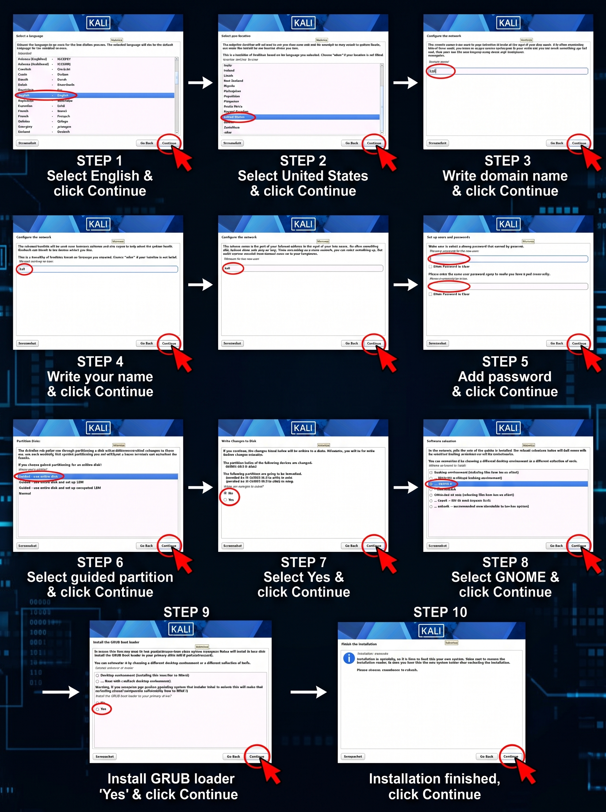

# 🚀 Cybersecurity Home Lab Setup Guide: Kali Linux & Metasploitable

Getting hands-on practice is crucial in cybersecurity. This repository contains a visual, step-by-step guide on how to set up your own local penetration testing home lab using VMware Workstation Pro. 

Having a safe, local, and isolated environment is the best way to practice scanning, enumeration, and exploitation techniques legally without impacting real-world networks.

## 🔗 Prerequisites & Downloads
Before starting, download the necessary software from the official sources:

VMware Workstation Pro:
   [Download Here](https://www.vmware.com/products/desktop-hypervisor/workstation-and-fusion)
Kali Linux (Attacker Machine):
    [Download Here](https://www.kali.org/)
Metasploitable 2 (Target Machine):
    [Download Here](https://sourceforge.net/projects/metasploitable/)

---

## 🛠️ Step-by-Step Installation Guide

### Step 1: Hypervisor Setup
First, install VMware Workstation Pro to host our virtual environments safely. 

### Step 2: Acquiring the Target
Download Metasploitable 2 from SourceForge and extract the ZIP file. This is an intentionally vulnerable Linux machine designed specifically for testing exploits.

### Step 3: Setting up the Attacker
Create a new Virtual Machine in VMware and install Kali Linux. Follow the guided setup for Language, Domain, User Setup, Partitioning, and installing the GRUB bootloader.

### Step 4: Firing it Up
In VMware, click "Open a Virtual Machine", locate your extracted Metasploitable file, review the hardware settings, and power on the machine. Your isolated lab is now ready!

---

## 🎓 Acknowledgments
A shoutout to [NetworkWalks](https://www.linkedin.com/company/networkwalks/) for the continued learning and inspiration in my cybersecurity journey!
